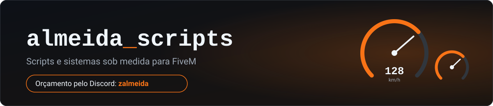

# Olá, eu sou o Diego 👋

Desenvolvo scripts e sistemas para servidores de **FiveM** (Lua, base QB-Core) e bots de Discord. Estou aprendendo programação na prática, criando ferramentas para resolver problemas reais, e documentando o caminho aqui. Moro em Minas Gerais, Brasil.

## 💼 Serviços para servidores FiveM
- Scripts e sistemas sob medida (QB-Core): facções, menus, HUDs, telas de carregamento e ajustes
- Correção de bugs e adaptação de scripts já existentes
- Bots de Discord integrados ao servidor (whitelist, banimentos e outros)

Combino o escopo antes de começar e entrego por etapas. Uso IA como apoio e testo tudo no servidor antes de entregar. Para orçamento, me chame no Discord: **zalmeida**

> Atendimento somente pelo Discord **zalmeida** e pelo servidor oficial da Almeida Scripts.

## ⭐ Scripts da Almeida Scripts

### 🆓 Gratuitos
Publicados com releases, instalação documentada, changelog e suporte pelo [Discord](https://discord.gg/dfuF2gz8NQ):

- **[alm_hud](https://github.com/dalmeidasdev/alm_hud)**: HUD para FiveM (QBCore e standalone), com vida, fome, sede, dinheiro, velocímetro e mais. Tudo configurável no `config.lua`, com consumo de cerca de 0,04 ms a pé (medido no `resmon`, servidor QBCore limpo).
- **[alm_loadscreen](https://github.com/dalmeidasdev/alm_loadscreen)**: tela de carregamento para servidores de RP, com nome e logo do servidor, cartões de teclas e novidades, dicas que trocam sozinhas, barra de progresso e player de música. Cada parte liga e desliga no `config.lua`, com textos em português e inglês e cores personalizáveis.
- **[alm_chat](https://github.com/dalmeidasdev/alm_chat)**: chat de RP que troca o `chat` padrão do FiveM sem quebrar os scripts que já mandam mensagem nele. Tem fala local com o nome do personagem, máscara, `/me` sobre a cabeça, `/do`, `/ooc`, `/try`, canais de grupo (polícia e staff), atalhos de ação, avisos e rádio da cidade, e um painel de configuração dentro do jogo (`/chatadmin`). Usa `oxmysql` só para guardar os ajustes do painel.

### 💰 Pagos
- **alm_detran** (R$ 79): Detran brasileiro para FiveM, com provas teóricas, CNH por categoria, sistema de pontos, radares, multas aplicadas pela polícia e painel de configuração dentro do jogo. Usa `oxmysql`.
- **alm_documentos** (R$ 39): documentos e identidade para servidores de RP, com carteira de identidade com CPF único, carteira digital, porte de arma analisado pela polícia, conferência dos cartões na abordagem (`/conferir`), licenças extras e painel de configuração no jogo. Usa `oxmysql`; `qb-inventory`, `qb-target` e `alm_detran` são opcionais. Funciona sozinho ou junto com o alm_detran.
- **alm_banco** (R$ 79): banco para servidores de RP que entra no lugar do `qb-banking` sem editar nenhum outro script, porque atende as mesmas chamadas (salário, multas, concessionária e outros continuam funcionando). Tem agências e caixas eletrônicos, depósito e saque, **Pix brasileiro** (chaves, limite diário e noturno, comprovante), contas compartilhadas, contas de empresa e de gangue com permissão por cargo, poupança, CDB, bolsa opcional, bloqueio cautelar pela polícia, painel de configuração no jogo (`/bancoadmin`) e auditoria de todo movimento. O servidor confere tudo, então o saldo não duplica por trapaça do cliente.
- **📦 Pacote Documentação** (alm_detran + alm_documentos): **R$ 89** em vez de R$ 118. Os dois continuam independentes e chegam juntos no mesmo ticket.

**Como comprar:** abra um ticket no [Discord da Almeida Scripts](https://discord.gg/dfuF2gz8NQ), confirme o pedido comigo, pague por Pix e receba o zip no próprio ticket.

> Os scripts foram testados no **QBCore**. O modo standalone está incluído, mas ainda não foi testado.

Precisa de algo diferente do que eles oferecem? Faço versões sob medida, é só me chamar no Discord.

## 🛠️ O que já construí
- **Servidor FiveM:** uma base própria de servidor, criada com apoio de IA. Eu defini as instruções e as ideias, apliquei tudo e fiz os testes, inclusive dos problemas que a IA não conseguiu resolver.
- **Bot de Discord da Almeida Scripts** (Python, `discord.py`): atende o servidor da marca com tickets de orçamento e de compra, horário de atendimento, cargos, FAQ, relatos de bug e depoimentos .
- **Bots de Discord para FiveM:** um deles integra com o servidor para liberar whitelist e aplicar banimentos.
- **Cidade dos Agentes:** mini cidade em pixel art que mostra em tempo real o que os agentes do Claude Code estão fazendo (Node.js, sem dependências) → [cidade-agentes](https://github.com/dalmeidasdev/cidade-agentes)
- **Automações em Python:** scripts com `pyautogui` para automatizar tarefas do dia a dia → [automacoes](https://github.com/dalmeidasdev/automacoes)
- **Autocleaner para PC:** ferramenta de limpeza do básico ao avançado, em PowerShell → [auto-cleaner](https://github.com/dalmeidasdev/auto-cleaner)

## 🤝 Como eu uso IA
Uso IA como ferramenta de apoio e deixo claro nos meus projetos quando ela participou e como. Nos projetos criados para treinar minhas habilidades de programação, escrevo o código sozinho.

## 📚 Estudando
- **Python:** lógica, funções, modularização e, em seguida, tratamento de erros e POO
- **Redes:** endereços IP e o modelo de camadas OSI
- **Infraestrutura:** máquinas virtuais e comandos básicos de Linux
- **Cibersegurança:** dando os primeiros passos

## 🧰 Tecnologias

## 📫 Contato
- Discord: **zalmeida**
- Comunidade e suporte: [Almeida Scripts no Discord](https://discord.gg/dfuF2gz8NQ)

